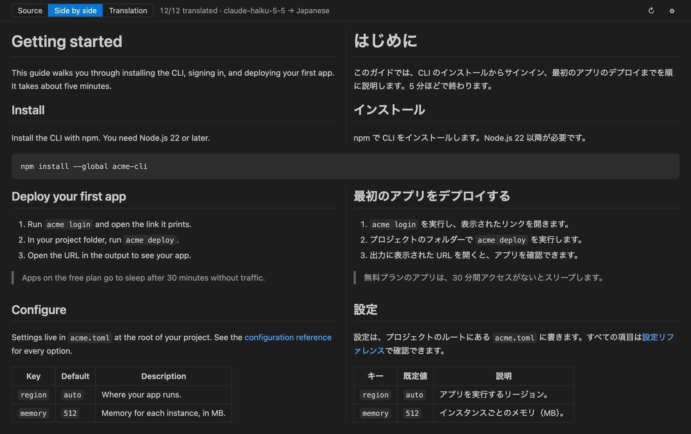
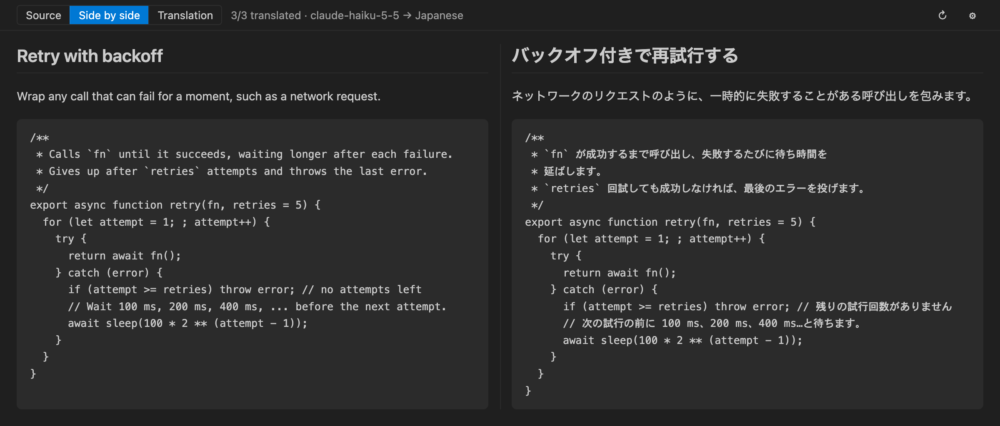

# Markdown Translation Preview

[English](README.md)

Markdown を原文と訳文で左右に並べてプレビューする VS Code 拡張機能です。翻訳には、自分の API キー（BYOK）で **Claude Haiku 5.5**（`claude-haiku-5-5`）か **GPT-6 Luna**（`gpt-6-luna`）を使います。



## 特長

- 見出し・段落・リスト項目・表のセル・引用をブロック単位で翻訳し、原文と訳文の高さを揃えて表示します。
- コードブロック、front matter、画像だけの段落、すでに訳文の言語で書かれた段落は翻訳せず、2 列にまたがって表示します。
- 設定でオンにすると、コードブロックのコメントも翻訳します。コメントを訳したコードを原文の横に並べます（送るのはコメントの文章だけです）。
- ツールバーで「原文」「並べて表示」「訳文」を切り替えられます。エディターとプレビューのスクロールは連動します。
- 画面に見えている部分から先に翻訳し、訳文は届いたそばから表示します。
- インラインコード、URL、リンク先、HTML は記号（`⟦1⟧` など）に置き換えて翻訳に出し、訳文に元のまま戻します。記号が欠けた訳文は自動で訳し直し、それでも直らなければ行に警告を出します。
- 翻訳結果は手元にキャッシュします（最大 20,000 件）。編集しても内容が変わっていないブロックは訳し直しません。
- 日本語に訳すときは、です・ます調にそろえます（翻訳者への追加の指示で変えられます）。用語集で訳語を固定できます。
- 狭いパネルでは、訳文を原文の下に並べます。
- 表示は日本語と英語に対応しています。

## 使い方

VS Code 1.101 以降と、Anthropic か OpenAI の API キーが必要です。

1. Visual Studio Marketplace から **Markdown Translation Preview** をインストールします。
2. Markdown ファイルを開き、エディター右上の地球のアイコン（**対訳プレビューを横に開く**）を押します。エクスプローラーの右クリックメニューや、コマンドパレットの **Bilingual Markdown: 対訳プレビューを開く** からも開けます。
3. 初めて開くと API キーを求める表示が出ます。**API キーを設定** を押して、キーを入力します。
4. 翻訳が始まります。失敗した行は、その行の **再試行** で訳し直せます。

翻訳先は日本語です。ほかの言語に訳すときは、`bilingualMarkdown.targetLanguage` を `English` や `Simplified Chinese` などに変えます。

| コマンド | 内容 |
| --- | --- |
| Bilingual Markdown: 対訳プレビューを開く | 対訳プレビューを開きます。 |
| Bilingual Markdown: 対訳プレビューを横に開く | エディターの横に開きます。 |
| Bilingual Markdown: 再翻訳（キャッシュを使わない） | 表示中の文書をキャッシュを使わずに訳し直します。 |
| Bilingual Markdown: API キーを設定 | API キーを登録します。 |
| Bilingual Markdown: API キーを削除 | 登録した API キーを削除します。 |
| Bilingual Markdown: 翻訳プロバイダーを切り替え | Anthropic と OpenAI を切り替えます。 |
| Bilingual Markdown: 翻訳キャッシュを消去 | 保存した翻訳結果を削除します。 |

## API キー（BYOK）

- Anthropic と OpenAI に対応しています。利用料金は、キーを発行したアカウントに請求されます。
- キーはパスワード入力欄から登録し、VS Code の Secret Storage（OS のキーチェーン）に保存します。`settings.json` には書きません。
- キーが拒否されたとき（認証エラーや権限不足）は翻訳を止め、プレビュー上でキーの再設定やプロバイダーの切り替えを案内します。

## 設定

| 設定 | 既定値 | 内容 |
| --- | --- | --- |
| `bilingualMarkdown.provider` | `anthropic` | 翻訳に使うプロバイダー（`anthropic` / `openai`）。 |
| `bilingualMarkdown.targetLanguage` | `Japanese` | 翻訳先の言語。翻訳者に伝えるように書きます（例: `English`、`Simplified Chinese`）。 |
| `bilingualMarkdown.anthropic.model` | `claude-haiku-5-5` | Anthropic のモデル ID。 |
| `bilingualMarkdown.openai.model` | `gpt-6-luna` | OpenAI のモデル ID。 |
| `bilingualMarkdown.openai.baseUrl` | （空欄） | OpenAI 互換 API のベース URL（社内ゲートウェイなど）。空欄なら `https://api.openai.com/v1` を使います。`https://` か、`localhost`・`127.0.0.1`・`[::1]` への `http://` だけが使えます。 |
| `bilingualMarkdown.reasoningEffort` | `none` | 回答の前にモデルが推論する量（`none` / `low` / `medium` / `high` / `default`）。翻訳には通常 `none` で足ります。 |
| `bilingualMarkdown.styleInstructions` | （空欄） | 翻訳者への追加の指示（例: `である調で書く`）。 |
| `bilingualMarkdown.glossary` | `{}` | 訳語を固定する用語集。`{ "pull request": "プルリクエスト" }` のように書きます。 |
| `bilingualMarkdown.translateCodeComments` | `false` | コードブロックのコメントも翻訳します。詳しくは「[コードのコメントの翻訳](#コードのコメントの翻訳)」を見てください。 |
| `bilingualMarkdown.maxConcurrentRequests` | `3` | 同時に送る翻訳リクエストの上限（1〜8）。 |
| `bilingualMarkdown.batchCharacterLimit` | `4000` | 1 回のリクエストで送る原文のおおよその文字数（500〜20000）。 |
| `bilingualMarkdown.syncScroll` | `true` | エディターとプレビューのスクロールを連動させます。 |

プロバイダー、モデル、ベース URL、推論の量、同時リクエスト数、1 回の文字数はユーザー設定でだけ変えられます。ワークスペースの設定ファイルでは変わりません。

## コードのコメントの翻訳

`bilingualMarkdown.translateCodeComments` をオンにすると、コードブロックのコメントも翻訳します。コメントがあるコードブロックは、左に原文のコード、右にコメントを訳したコードを並べて表示します。



- 送るのはコメントの文章だけで、コードは送りません。文字列の中の `//` や `#` はコメントとして扱いません。
- 何行も続くコメントは 1 つの文章としてまとめて訳し、元のコメントの幅で折り返します。行末のコメントは 1 行のまま訳します。
- `eslint-disable`、`@ts-ignore`、`# noqa`、`//go:build` のような、ツールが読むコメントは訳しません。すでに訳文の言語で書かれたコメントも訳しません。
- 対象は、```` ```python ```` のように開始フェンスに言語名を書いたコードブロックです。対応している言語は次のとおりです。
  - `//` と `/* */`: JavaScript、TypeScript、C、C++、C#、Java、Kotlin、Scala、Swift、Dart、Go、Rust、PHP、Protocol Buffers、JSON（コメント付き）
  - `#`: Python、Ruby、Perl、R、Elixir、シェル（sh、bash、zsh など）、PowerShell、YAML、TOML、Dockerfile、Makefile、CMake、Terraform（HCL）、GraphQL、nginx
  - そのほか: CSS、SCSS、Less、SQL、Lua、Haskell、Clojure などの Lisp、INI、HTML、XML

## セキュリティとプライバシー

- 翻訳する文章は、選んだプロバイダーの API に送ります。送信先は `https://api.anthropic.com`、`https://api.openai.com/v1`、またはユーザー設定の `bilingualMarkdown.openai.baseUrl` だけです。`ANTHROPIC_BASE_URL`、`OPENAI_BASE_URL`、`OPENAI_ORG_ID`、`OPENAI_PROJECT_ID` などの環境変数は使いません。
- コードブロック、front matter、インラインコード、URL、リンク先、HTML は送りません。ただし `bilingualMarkdown.translateCodeComments` をオンにしたときは、コードブロックのコメントの文章を送ります。
- 制限モード（信頼していないワークスペース）では、翻訳先の言語・追加の指示・用語集・コメントの翻訳もユーザー設定の値だけを使います。
- 利用状況のデータ（テレメトリー）は集めません。
- プレビューは厳格な Content Security Policy の下で表示し、Markdown 中の HTML は DOMPurify で無害化します。文書中のスクリプトやコマンド URI は実行しません。
- リンクは `http`、`https`、`mailto` をブラウザーなどの外部アプリで開き、相対パスは VS Code で開きます。それ以外のスキームは開きません。

## 既知の制限

- `<details>` など HTML ブロックの中に Markdown を書くと、ブロックごとに別の行として表示されます（開閉はできません）。
- すでに訳文の言語で書かれた段落やコメントを見分けられるのは、翻訳先が日本語のときだけです。ほかの言語では、その言語で書かれた段落やコメントも翻訳に送ります。
- 数式や Mermaid の図は描画せず、元の記法のまま表示します。
- コメントの翻訳は、Python の docstring や文字列の中の文章を訳しません。インデントで書いたコードブロックや、言語名のないコードブロックのコメントも訳しません。

## 開発に参加する

不具合の報告やプルリクエストは [GitHub](https://github.com/yhay81/bilingual-markdown-preview/issues) で受け付けています。ビルドとテストの方法は [CONTRIBUTING.md](CONTRIBUTING.md)（英語）にあります。

## ライセンス

[MIT](LICENSE)。拡張機能に同梱しているサードパーティのライブラリのライセンスは、パッケージ内の `dist/ThirdPartyNotices.txt` にまとめています。
