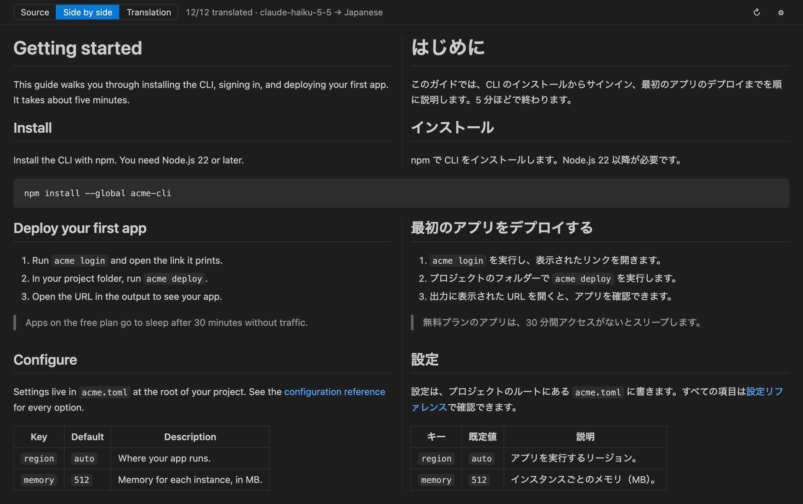
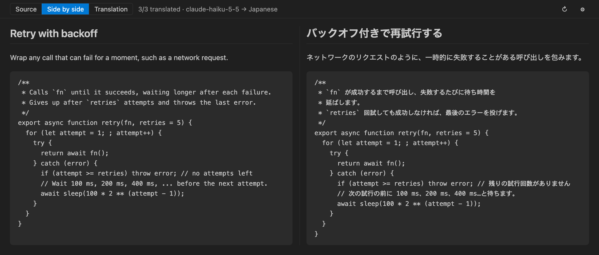

# Markdown Translation Preview

[日本語](README.ja.md)

Preview Markdown with an LLM translation beside it, block by block, into any language. Translate with **GitHub Copilot** or another language model in VS Code; with your own API key (BYOK) for **Anthropic**, **OpenAI**, **OpenRouter**, **Vercel AI Gateway**, **Google Gemini**, **DeepSeek**, **Mistral AI** or **xAI**; with a model in **Microsoft Azure**, **Amazon Bedrock** or **Google Cloud Vertex AI**; or with a model running on your computer.



## Features

- Translates headings, paragraphs, list items, table cells and block quotes one block at a time, and lines each translation up with its source.
- Leaves code blocks, front matter, image-only paragraphs and paragraphs already in the target language untranslated, and shows them across both columns.
- Can also translate the comments in code blocks, and show the code with its comments translated beside the original. Only the comment text is sent.
- Switches between Source, Side by side and Translation from the toolbar. The editor and the preview scroll together.
- Translates what is on screen first, and shows each translation as it arrives. Each request carries the text just before it, so terms and tone stay consistent.
- Sends inline code, URLs, link targets and HTML as placeholders such as `⟦1⟧`, and puts them back unchanged. A translation that drops a placeholder is translated again automatically; if it still fails, the row shows a warning.
- Caches translations on your computer (up to 20,000 entries). After an edit, only the blocks that changed are translated again.
- Lets you correct a translation by hand. Your edits are kept, and can be reverted to the machine translation.
- Saves the translation as a Markdown file, such as `README.ja.md`, with code, links and markup exactly as in the source.
- Renders math (`$…$` and `$$…$$`) with KaTeX and Mermaid diagrams, and folds `<details>` blocks on both sides at once.
- Japanese translations use the polite です・ます style unless your style instructions say otherwise. A glossary fixes the translation of terms, in your settings or in a file the whole team shares.
- Translates into any language you can name. Click the language in the preview's toolbar to choose another, and a document can name its own target language in its front matter.
- Lets you pick a model from the ones your provider offers: click the model name in the preview's toolbar.
- Can pause after a number of tokens, and shows how many tokens were used.
- In a narrow panel, the translation goes under the source.
- The interface is in English, Japanese, Simplified Chinese and Korean.

## Getting started

You need VS Code 1.101 or later, and one of these: GitHub Copilot; an API key from Anthropic, OpenAI, OpenRouter, Vercel AI Gateway, Google Gemini, DeepSeek, Mistral AI or xAI; an API key for Microsoft Azure, Amazon Bedrock or Google Cloud Vertex AI; or a local server such as Ollama or LM Studio.

1. Install **Markdown Translation Preview** from the Visual Studio Marketplace.
2. Open a Markdown file and click the globe icon (**Open Translation Preview to the Side**) at the top right of the editor. You can also right-click the file in the Explorer, or run **Markdown Translation: Open Translation Preview** from the Command Palette.
3. The first time, the preview asks for an API key. Click **Set API Key** and enter the key, or click **Switch Provider** and choose **VS Code Language Model** to use GitHub Copilot.
4. Translation starts. If a row fails, click **Retry** on that row.

The preview translates into Japanese. To translate into another language, click the language (**→ Japanese**) in the preview's toolbar, or run **Markdown Translation: Choose Target Language**. Pick a common language from the list, or choose **Another language...** and type any language as you would tell a translator, such as `Swahili` or `Brazilian Portuguese`. The choice is stored in `markdownTranslation.targetLanguage`. A single document can ask for another language in its front matter:

```markdown
---
translate-to: French
---
```

## Commands

| Command | What it does |
| --- | --- |
| Markdown Translation: Open Translation Preview | Opens the preview. |
| Markdown Translation: Open Translation Preview to the Side | Opens the preview beside the editor. |
| Markdown Translation: Retranslate (Ignore Cache) | Translates the document in the preview again, without the cache. |
| Markdown Translation: Save Translation as Markdown | Saves the translation as a Markdown file. Also on the preview's toolbar. |
| Markdown Translation: Set API Key | Stores an API key. |
| Markdown Translation: Clear API Key | Deletes a stored API key. |
| Markdown Translation: Switch Translation Provider | Switches to another provider, such as OpenRouter or a language model in VS Code. |
| Markdown Translation: Choose Model | Chooses the model of the current provider from the models it offers, or takes a model ID you type. Clicking the model name in the preview's toolbar does the same. |
| Markdown Translation: Choose Target Language | Chooses the language to translate into, from common languages or any language you type. Clicking the language in the preview's toolbar does the same. |
| Markdown Translation: Clear Translation Cache | Deletes the cached translations. |

## Providers and cost

### GitHub Copilot and other language models in VS Code

Set `markdownTranslation.provider` to `vscode`, or run **Markdown Translation: Switch Translation Provider** and choose **VS Code Language Model**. No API key is needed: the extension uses a language model that another extension, such as GitHub Copilot, makes available in VS Code.

- The first time, VS Code asks whether this extension may use the model. If you declined, allow it again from the Accounts menu under **Manage Language Model Access**.
- **Markdown Translation: Choose Model** lists the models you can use. With `markdownTranslation.vscode.model` empty, the first GitHub Copilot model is used.
- Requests count against your Copilot plan, as chat does.

### Your own API key

| Provider | `markdownTranslation.provider` | Default model |
| --- | --- | --- |
| [Anthropic](https://www.anthropic.com) | `anthropic` | `claude-haiku-5-5` |
| [OpenAI](https://openai.com) | `openai` | `gpt-6-luna` |
| [OpenRouter](https://openrouter.ai) | `openrouter` | `google/gemini-3.8-flash` |
| [Vercel AI Gateway](https://vercel.com/ai-gateway) | `vercel` | `google/gemini-3.8-flash` |
| [Google Gemini](https://aistudio.google.com) | `gemini` | `gemini-3.8-flash` |
| [DeepSeek](https://www.deepseek.com) | `deepseek` | `deepseek-flash` |
| [Mistral AI](https://mistral.ai) | `mistral` | `mistral-small-2603` |
| [xAI](https://x.ai) | `xai` | `grok-4.3` |

Run **Markdown Translation: Switch Translation Provider**, choose a provider and enter its key. Each provider keeps its own key and its own model, so you can switch back and forth.

- To use another model, run **Markdown Translation: Choose Model**, or click the model name in the preview's toolbar. It lists the models your key can use; you can also type a model ID. The model is stored in `markdownTranslation.<provider>.model`.
- OpenRouter and Vercel AI Gateway reach many providers' models with one key and one bill. Their model IDs name the provider, as in `anthropic/claude-haiku-5.5` or `openai/gpt-6-luna`.
- Translation is billed to the account that issued the key.
- You enter the key in a password box. It is kept in VS Code Secret Storage (your OS keychain), never in `settings.json`.
- If the provider rejects the key (an authentication or permission error), translation stops, and the preview offers to set the key again or to switch providers.
- With `markdownTranslation.reasoningEffort` at `none`, models that cannot stop reasoning, such as Gemini and Grok models, reason at their lowest level. When a model rejects a reasoning setting, the next lower one is tried, and finally none at all.
- The Gemini API's free tier may use what you send to improve Google's products, and people may read it. Do not send confidential documents on the free tier.
- The toolbar shows the tokens used in this VS Code session. `markdownTranslation.tokenLimit` pauses translation after that many tokens, until you click **Continue**.

### Azure, AWS and Google Cloud

If your organization uses a cloud platform, you can translate with a model there, billed to that cloud account. Each takes an API key, stored like the others; sign-in with Microsoft Entra ID, AWS credentials or Google OAuth is not supported.

| Platform | `markdownTranslation.provider` | Default model |
| --- | --- | --- |
| [Microsoft Azure](https://ai.azure.com) (Azure AI Foundry, Azure OpenAI) | `azure` | `gpt-6-luna` (a deployment name) |
| [Amazon Bedrock](https://aws.amazon.com/bedrock/) | `bedrock` | `global.anthropic.claude-haiku-5-5` |
| [Google Cloud Vertex AI](https://cloud.google.com/vertex-ai) | `vertex` | `gemini-3.8-flash` |

- **Azure**: Use a key of your Azure AI Foundry or Azure OpenAI resource. When you switch to Azure, the preview asks for the resource's endpoint, such as `https://my-resource.services.ai.azure.com`, or just the resource name; it is stored in `markdownTranslation.azure.endpoint`. Then choose the model by its deployment name: Azure does not list deployments to a key, so type it. Deployments with `claude` in the name are called through Azure's Anthropic API, others through its OpenAI API.
- **Amazon Bedrock**: Use a Bedrock API key, and set `markdownTranslation.bedrock.region` to the region it was made in (`us-east-1` by default). Claude models are called through Bedrock's Anthropic API, and other models, such as `openai.gpt-oss-120b-1:0`, through its OpenAI-compatible API. **Choose Model** suggests a few models; type the ID of any other model or inference profile.
- **Google Cloud Vertex AI**: Use an API key for the Vertex AI API from the Google Cloud console. With an API key, Vertex AI serves Google's own Gemini models only; Claude and other partner models on Vertex AI need OAuth, which is not supported.

### Local models

Any server with an OpenAI-compatible API works. Set `markdownTranslation.provider` to `openai`, and in your user settings point `markdownTranslation.openai.baseUrl` at the server and `markdownTranslation.openai.model` at a model it serves. A server on your own computer needs no API key.

| Server | `markdownTranslation.openai.baseUrl` |
| --- | --- |
| [Ollama](https://ollama.com) | `http://localhost:11434/v1` |
| [LM Studio](https://lmstudio.ai) | `http://localhost:1234/v1` |
| llama.cpp (`llama-server`) | `http://localhost:8080/v1` |

Small models translate less accurately and more often drop the placeholders that stand for code and links; the preview then shows a warning on the row.

## Settings

| Setting | Default | Description |
| --- | --- | --- |
| `markdownTranslation.provider` | `anthropic` | Translation provider: `anthropic`, `openai`, `openrouter`, `vercel`, `gemini`, `deepseek`, `mistral`, `xai`, `azure`, `bedrock`, `vertex`, or `vscode` for a language model in VS Code. |
| `markdownTranslation.targetLanguage` | `Japanese` | Language to translate into: any language, written as you would tell a translator, such as `English`, `Simplified Chinese` or `Swahili`. `translate-to` in a document's front matter overrides it. |
| `markdownTranslation.anthropic.model` | `claude-haiku-5-5` | Anthropic model ID. |
| `markdownTranslation.openai.model` | `gpt-6-luna` | OpenAI model ID. |
| `markdownTranslation.openai.baseUrl` | (empty) | Base URL of an OpenAI-compatible API, such as a company gateway or a [local server](#local-models). Empty means `https://api.openai.com/v1`. Only `https://` URLs, and `http://` URLs to `localhost`, `127.0.0.1` or `[::1]`, are accepted. |
| `markdownTranslation.openrouter.model` | `google/gemini-3.8-flash` | OpenRouter model ID, as `provider/model`. |
| `markdownTranslation.vercel.model` | `google/gemini-3.8-flash` | Vercel AI Gateway model ID, as `provider/model`. |
| `markdownTranslation.gemini.model` | `gemini-3.8-flash` | Gemini model ID. |
| `markdownTranslation.deepseek.model` | `deepseek-flash` | DeepSeek model ID. |
| `markdownTranslation.mistral.model` | `mistral-small-2603` | Mistral model ID. |
| `markdownTranslation.xai.model` | `grok-4.3` | xAI model ID. |
| `markdownTranslation.azure.endpoint` | (empty) | Endpoint of your Azure resource, such as `https://my-resource.services.ai.azure.com`, or the resource name alone. |
| `markdownTranslation.azure.model` | `gpt-6-luna` | Deployment name of the model in your Azure resource. |
| `markdownTranslation.bedrock.region` | `us-east-1` | AWS region for Amazon Bedrock. The API key must be from this region. |
| `markdownTranslation.bedrock.model` | `global.anthropic.claude-haiku-5-5` | Amazon Bedrock model ID or inference profile. |
| `markdownTranslation.vertex.model` | `gemini-3.8-flash` | Gemini model ID on Vertex AI. |
| `markdownTranslation.vscode.model` | (empty) | Language model in VS Code, as a model ID or family. Empty means the first GitHub Copilot model. |
| `markdownTranslation.reasoningEffort` | `none` | How much the model reasons before it answers: `none`, `low`, `medium`, `high` or `default`. `none` is usually enough for translation. |
| `markdownTranslation.styleInstructions` | (empty) | Extra instructions for the translator, such as `Use the plain である style.` |
| `markdownTranslation.glossary` | `{}` | Fixed translations for terms, such as `{ "pull request": "プルリクエスト" }`. See [Glossary file](#glossary-file). |
| `markdownTranslation.translateCodeComments` | `false` | Also translate the comments in code blocks. See [Translating code comments](#translating-code-comments). |
| `markdownTranslation.maxConcurrentRequests` | `3` | Maximum number of translation requests in flight at once (1–8). |
| `markdownTranslation.batchCharacterLimit` | `4000` | Approximate number of source characters in one request (500–20000). |
| `markdownTranslation.tokenLimit` | `0` | Pause translation after this many tokens in one VS Code session. `0` means no limit. Counted when the provider reports token usage; language models in VS Code and some local servers do not. |
| `markdownTranslation.syncScroll` | `true` | Keeps the editor and the preview scrolled to the same place. |

The provider, the models, the base URL, the Azure endpoint, the Bedrock region, the reasoning effort, the number of requests, the request size and the token limit can be changed only in your user settings. A workspace's settings do not change them.

## Glossary file

A team can share its glossary in `.vscode/translation-glossary.json` at the root of the workspace:

```json
{
  "pull request": "プルリクエスト",
  "deploy": "デプロイ"
}
```

The preview reads the file again when it changes. When a term is both in the file and in `markdownTranslation.glossary`, the setting wins.

## Editing and saving the translation

- Hover over a translation and click ✎ to correct it. **Save** (or Ctrl+Enter / Cmd+Enter) keeps your text; Escape cancels. An edited row shows **Edited**, and **Revert** goes back to the machine translation. Edits are kept on your computer, survive retranslation, and are not deleted by **Clear Translation Cache**.
- Click ⤓ on the toolbar, or run **Markdown Translation: Save Translation as Markdown**, to save the translation as a Markdown file next to the document, such as `README.ja.md`. Code, links, front matter and blank lines are copied as written, and your edits are included. Text that is not translated yet is saved as written, and the extension tells you how much.

## Math, diagrams and details

- Math between `$…$` and `$$…$$` is rendered with KaTeX, as in VS Code's own Markdown preview. Math is never sent for translation.
- Code blocks marked ```` ```mermaid ```` are drawn as diagrams. The diagram library loads only when a document has one.
- A `<details>` block folds and opens on both sides together, and the text of its `<summary>` is translated.

## Translating code comments

Turn on `markdownTranslation.translateCodeComments` to translate the comments in code blocks too. A code block with comments then shows the original code on the left and the code with its comments translated on the right.



- Only the comment text is sent, never the code. A `//` or `#` inside a string is not taken for a comment.
- A comment that spans several lines is translated as one passage and wrapped to the width of the original comment. A comment at the end of a line stays on one line.
- Comments that tools read, such as `eslint-disable`, `@ts-ignore`, `# noqa` and `//go:build`, are not translated, and neither are comments already in the target language.
- The code block's language must be named after its opening fence, as in ```` ```python ````. These languages are supported:
  - `//` and `/* */`: JavaScript, TypeScript, C, C++, C#, Java, Kotlin, Scala, Swift, Dart, Go, Rust, PHP, Protocol Buffers, JSON with comments
  - `#`: Python, Ruby, Perl, R, Elixir, shells (sh, bash, zsh and others), PowerShell, YAML, TOML, Dockerfile, Makefile, CMake, Terraform (HCL), GraphQL, nginx
  - Others: CSS, SCSS, Less, SQL, Lua, Haskell, Clojure and other Lisps, INI, HTML, XML

## Security and privacy

- The text to translate is sent only to the provider you choose: `https://api.anthropic.com`, `https://api.openai.com/v1`, `https://openrouter.ai/api/v1`, `https://ai-gateway.vercel.sh/v1`, `https://generativelanguage.googleapis.com`, `https://api.deepseek.com`, `https://api.mistral.ai/v1`, `https://api.x.ai/v1`, `https://bedrock-runtime.<region>.amazonaws.com`, `https://aiplatform.googleapis.com`, the `markdownTranslation.openai.baseUrl` or `markdownTranslation.azure.endpoint` in your user settings, or the language model in VS Code that you allowed. Each key is sent only to its own provider. Environment variables such as `ANTHROPIC_BASE_URL`, `OPENAI_BASE_URL`, `OPENAI_ORG_ID` and `OPENAI_PROJECT_ID` are not used.
- Code blocks, front matter, inline code, math, URLs, link targets and HTML are not sent. With `markdownTranslation.translateCodeComments` on, the text of the comments in code blocks is sent.
- In Restricted Mode (an untrusted workspace), the target language, style instructions, glossary and code comment translation also come only from your user settings. The glossary file and `translate-to` in front matter are not used.
- The extension collects no telemetry.
- The preview runs under a strict Content Security Policy, and HTML in the Markdown is sanitized with DOMPurify. Scripts and command URIs in a document never run.
- `http`, `https` and `mailto` links open in your browser or mail app, and relative links open in VS Code. Links with other schemes do not open.

## Known limitations

- Text already in the target language is recognized for Japanese, Chinese, Korean, Russian, Ukrainian, Greek, Arabic, Hebrew, Thai, Hindi, Vietnamese, English, Spanish, French, German, Portuguese, Italian, Dutch, Polish, Turkish and Indonesian. It is recognized only when it is clearly in that language; short or mixed text is sent for translation.
- Text in other HTML blocks than `<summary>` is not translated.
- Comment translation does not translate Python docstrings or other text in strings, or the comments in indented code blocks and in code blocks without a language.

## Contributing

Bug reports and pull requests are welcome on [GitHub](https://github.com/yhay81/markdown-translation-preview/issues). [CONTRIBUTING.md](CONTRIBUTING.md) explains how to build and test the extension.

## License

[MIT](LICENSE). The licenses of the third-party libraries bundled with the extension are in `dist/ThirdPartyNotices.txt` inside the package.
